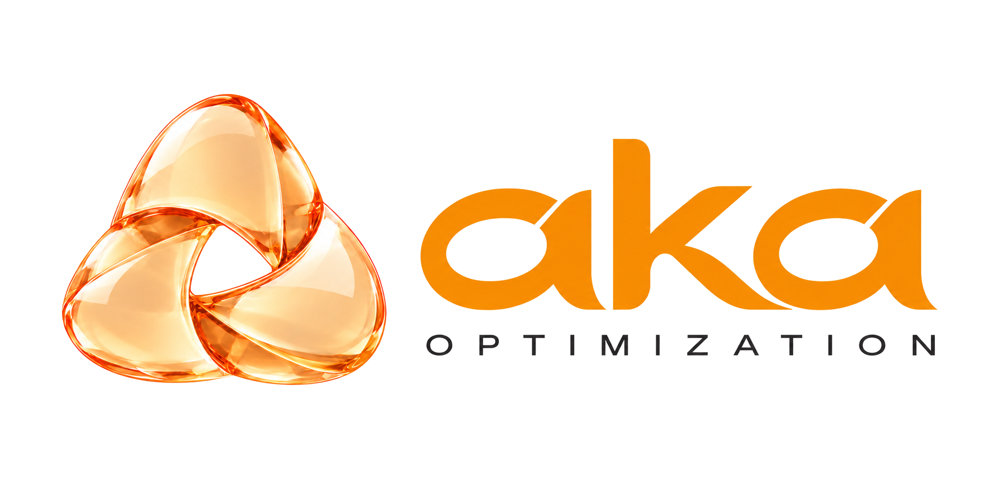

<p align="center">
  <picture>
    <source media="(prefers-color-scheme: dark)" srcset="./assets/brand/aka-wordmark-light-text.png">
    <source media="(prefers-color-scheme: light)" srcset="./assets/brand/aka-wordmark-dark-text.png">
    
  </picture>
</p>

<p align="center">
  <a href="#get-started"></a>
  <a href="./LICENSE"></a>
  <a href="./docs/workflow-reference.md"></a>
</p>

<p align="center"><strong>Engineering and algorithm optimization.</strong></p>

<p align="center">
  <a href="#get-started">Get started</a> |
  <a href="#what-could-you-try">Examples</a> |
  <a href="./docs/workflow-reference.md">Workflow</a> |
  <a href="./CHANGELOG.md">Changelog</a> |
  <a href="./SUPPORT.md">Support</a> |
  <a href="./PRIVACY.md">Privacy</a> |
  <a href="./TERMS.md">Terms</a>
</p>

# Aka Optimization

Aka Optimization is a workflow for engineering and algorithm optimization with
Codex and other compatible coding agents. It helps you define what to improve,
research possible approaches, implement changes, and measure their effects.
The results guide what to try next, while saved experiments and findings let
you review earlier work and continue from where you left off.

## What could you try?

| Something you want to improve | A way to ask |
|---|---|
| A program that takes too long to run | “Help this program run faster without changing its results.” |
| A model that costs too much to run | “Help me investigate ways to reduce this model's inference cost while preserving the quality we agree to measure.” |
| An algorithm with alternatives to compare | “Help me compare algorithm approaches under the same computing budget.” |

These are starting examples, not reports of measured improvements. Bring the
files and information needed for your task. Aka helps work out how to compare
the options; real-world changes may still need your involvement.

## Get started

This repository provides version **1.2.0**: thirteen workflow Skills plus the
`setup-noehub` Skill, which connects a project to the workflow. Use a Git
repository for your project. Retain the commits and artifacts used for reviews,
results, and recovery; a remote repository is optional.

**Before you start:** you need Python 3.10 or later, PyYAML 6.x, and a host
that provides separate review conversations, such as Codex. The workflow plans
and measures before it changes code, so even a small task can take 15 to 30
minutes, and it can create Git commits in your project. Setup, a complete task,
and continuation have been tested in the Codex desktop app on macOS. Linux is
untested and the helper scripts do not support Windows.

### Codex desktop plugin

Add this repository as a plugin marketplace and install the plugin:

```sh
codex plugin marketplace add Noehub2025/noehub-factory-optimization
codex plugin add noehub-factory-optimization@noehub
```

Restart the Codex app, open your project, and start each request with the
`@Aka Optimization` plugin mention:

```text
@Aka Optimization Help me set up Aka Optimization for this project.
@Aka Optimization Use Aka Optimization to help this program run faster without changing its results.
@Aka Optimization Use Aka Optimization to continue the task I choose from where we left off.
```

Setup checks Git, Python, and PyYAML, keeps your existing project instructions,
and adds a short link plus two files under `.noehub/`. It does not start
experiments or install dependencies. When setup is done, skip to
[Start a task](#3-start-a-task).

### 1. Install the Skills in other agents

Choose one installation method. **Install all Skills together**, even though
you normally invoke only the two coordinators.

**Agent Skills-compatible agents**

```sh
npx skills@latest add Noehub2025/noehub-factory-optimization
```

Select all Skills and your target agent in the installer.

**Claude Code plugin**

Run these commands inside Claude Code:

```text
/plugin marketplace add Noehub2025/noehub-factory-optimization
/plugin install noehub-factory-optimization@noehub
```

The plugin installs the Skills as one bundle. For a version-pinned checkout or
manual installation, see the [installation guide](./docs/installation.md).

### 2. Add the project instructions

The Codex desktop plugin's setup Skill does this for you. For other agents:

Copy [`AGENTS.md`](./AGENTS.md) into your project root. If one already exists,
merge the three shared sections while preserving the project's existing rules.

For Claude Code, the included [`CLAUDE.md`](./CLAUDE.md) imports those instructions
with `@AGENTS.md`. Add that import once to an existing root `CLAUDE.md`, or copy
the adapter if the project has none. Skills installation and plugin installation
do not replace this step.

See [shared instruction setup](./docs/agent-instructions.md) for existing files,
nested instructions, direct Claude Code support, and verification. Start a new
agent session after setup and confirm that the project instructions are loaded.

### 3. Start a task

Describe your objective and ask for both stages. For example:

```text
I want to reduce inference cost while preserving the quality we agree to measure.
Use frame-optimization to define and review inference-cost-reduction,
then continue with frontier-optimization within the adopted objective,
budget, access, and effect limits.
```

The agent saves the task under
`docs/skills/optimization/inference-cost-reduction/`. Later sessions can resume
from that directory and its referenced history and artifacts.

To define and review the task first, request only `frame-optimization`. To start
the campaign after framing is ready:

```text
Use frontier-optimization to start the campaign for
docs/skills/optimization/inference-cost-reduction/.
```

## What to expect

- The approaches that were tried and what happened.
- A comparison that explains which changes helped, which did not, and what is
  still uncertain.
- A recommendation for the next useful step, including any choice you need to make.
- Saved project records so a later session can continue from the same work.

Some attempts will fail. The aim is to learn which directions deserve more work,
including better alternatives to the approach you started with. Aka does not
guarantee an improvement or a particular score.

## How it works

You and Aka first agree on what a useful improvement would look like, how to
recognize it, and what can change. Aka then investigates promising approaches,
tries the ones worth pursuing, and compares the results. What it learns guides
the next attempt or a change in direction. Work stays within your agreed limits.

The following names are useful when you need the detailed controls:

| Skill | What it helps with |
|---|---|
| [frame-optimization](skills/frame-optimization/SKILL.md) | Clarify the goal, comparison rules, and possible changes before starting. |
| [frontier-optimization](skills/frontier-optimization/SKILL.md) | Research and try approaches, compare results, and continue or change direction. |

They coordinate the other Skills for research, design, implementation, review,
and questions that need your judgment. Task records live under
`docs/skills/optimization/<task-slug>/`. Their goals, decisions, observations,
and linked files help later sessions recover the work. See the
[workflow reference](docs/workflow-reference.md) for the full structure.

The public name is Aka Optimization. The installation identifier remains
`noehub-factory-optimization`, so existing installation commands continue to work.

## Optional Codex Hook

The Skills and project instructions are the starting point. An optional
[Rust execution harness](./tools/workflow-harness/README.md) supports controlled
execution and recovery. Its [Codex Hook](./.codex/hooks.json) restores saved work
context and observes supported agent dispatches.

**The Hook supports Codex only.** It is separate from the Claude Code plugin,
grants no permission, and does not automatically continue a session. Setup
requires building the binary and trusting the project Hook definition; see
[Hook installation](./docs/installation.md#optional-codex-hook).

## Documentation

| If you want to… | Read |
|---|---|
| Install a specific version or copy Skills manually | [Installation guide](./docs/installation.md) |
| Merge instructions into an existing project | [Shared agent instructions](./docs/agent-instructions.md) |
| Browse all Skills and understand the detailed rules | [Workflow reference](./docs/workflow-reference.md) |
| Check desktop dependencies and what has been tested | [Desktop plugin guide](./docs/desktop-plugin.md) |
| Maintain shared evaluation, packaging, or submission tools | [Reusable project capabilities](./docs/project-capabilities.md) |
| Configure execution, recovery, or the Codex Hook | [Harness guide](./tools/workflow-harness/README.md) |
| Check release changes or publish a release | [Changelog](./CHANGELOG.md) · [Release procedure](./docs/releasing.md) |

The public release is **1.2.0**. Public and development versions use separate
version series.

## Support and privacy

Aka Optimization is published by **PARTNERNET SOFTWARE PTY LTD**
(ACN 621 438 622), Sydney, Australia, and developed by **Noehub**, Hangzhou Boshu
Technology Co., Ltd. Existing installation names remain unchanged. Read the
[privacy policy](./PRIVACY.md), [terms of service](./TERMS.md), and
[support information](./SUPPORT.md), or contact
[support@noehub.com](mailto:support@noehub.com).

## License

Copyright (c) 2026 Ken Chen.

This project is licensed under the
[GNU General Public License version 3 only](./LICENSE) (`GPL-3.0-only`).

The historical public [`v1.1.0` tag](https://github.com/Noehub2025/noehub-factory-optimization/tree/v1.1.0)
retains its [MIT license](https://github.com/Noehub2025/noehub-factory-optimization/blob/v1.1.0/LICENSE).
The default branch later changed to GPL-3.0-only. Read the license in the source
version you install.
